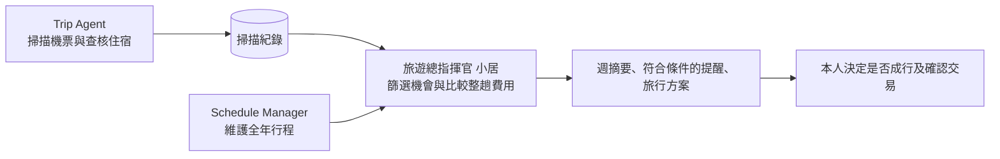

# Hermes 旅遊工作流

用 Hermes 把掃描、全年行程和旅行提案串在一起。這個專案包含 Trip Bot 掃描器、三個 Hermes 角色、交接看板、排程和空白資料範本。



| Hermes profile | Telegram 顯示名稱 | 工作 |
| --- | --- | --- |
| `trip` | Trip Agent | 掃描機票，查詢住宿與價差 |
| `travel-commander` | 旅遊總指揮官 小居 | 整合日期、整趟費用與候選方案 |
| `schedule-manager` | Schedule Manager | 管理滾動十二個月的行程，核對完整出遊時段 |

表中的名稱用來對照聊天機器人。舊版使用 `project-manager` 與 `us-market` 作為 profile ID；用舊版裝好的 Hermes 資料目錄請保留原 ID，或改用新的資料目錄重新安裝。Telegram Bot 的名稱由 Telegram 帳號端設定。三個 profile 使用原生 Hermes 的 `command-center` Kanban 交接。專員在原卡片附上可核對的成果，旅遊總指揮官覆核後才結案。日曆由 Schedule Manager 寫入，旅行偏好與機會紀錄由旅遊總指揮官維護。

## 在 Windows 安裝

準備 Hermes CLI、Git、Node.js 24 以上、npm 和 Python 3.11 以上。安裝流程使用 Hermes 0.23.0 驗證。選擇位於 Git checkout 外的新 Hermes 資料目錄，每套環境使用獨立的 checkout。

```powershell
git clone https://github.com/baka9881/hermes-travel-workflow.git
Set-Location hermes-travel-workflow
npm --prefix scanner ci --ignore-scripts
npm --prefix scanner exec -- playwright install chromium

$workflowRoot = Join-Path $env:LOCALAPPDATA "hermes-travel-workflow"
py -3 .\setup.py install --root "$workflowRoot"
$env:HERMES_HOME = $workflowRoot

hermes profile list
hermes kanban --board command-center list
hermes -p trip cron list --all
hermes -p travel-commander cron list --all
```

安裝會建立三個暫停的排程，預設將結果留在 Hermes 本機紀錄。請在這個 Hermes 資料目錄設定三個 profile 的模型。若希望摘要和提醒送到 Telegram，執行 `py -3 .\setup.py delivery telegram --root "$workflowRoot"`（或首次安裝時加上 `--deliver telegram`），並為 `travel-commander` 本機設定已授權的 Telegram Bot 與 home channel。掃描器的輸出留在本機。透過 Hermes 管理模型和帳號憑證。

安裝會把每個 profile 設成每天 04:00 後的第一則訊息開新對話（`session_reset`）。Hermes 0.21 起要另外裝外掛才會生效：`hermes plugins install hermes-session-reset-policy`，再 `hermes plugins enable hermes-session-reset-policy`。開新對話後，代理靠機會紀錄裡的 `pending_question` 接上前一天沒回答的按鈕問題；對不上時用 Hermes 內建的 `session_search` 搜舊對話。長期不變的偏好（同行人數、出發機場、不住共用衛浴等）由代理用 `memory` 記下，換新對話也記得。 [Hermes 排程](https://hermes-agent.nousresearch.com/docs/user-guide/features/cron)

## 啟動與第一次使用

在上面的 PowerShell 繼續操作。

1. 在 Trip Agent 指定欲監看的區域。內附掃描器的 `add-region` 會建立台北出發的監控。
2. 請 Schedule Manager 核對你提供的日曆或 ICS，並記下資料涵蓋範圍。課業的截止日與實際占用的時段分開。
3. 告訴旅遊總指揮官整趟預算、人數、旅行長度及目的地限制。單次旅行條件留在當次機會。
4. 在 Hermes 啟動負責三個 profile 的 gateway，確認可派工後啟用所需排程。模型、Telegram 和 gateway 的設定依安裝方式及已授權的帳號而定。 [Hermes Kanban 派工](https://hermes-agent.nousresearch.com/docs/user-guide/features/kanban)

```powershell
py -3 "$env:HERMES_HOME/profiles/trip/scripts/scan-trip.py" add-region Japan 日本
py -3 "$env:HERMES_HOME/profiles/trip/scripts/scan-trip.py" regions

py -3 .\setup.py resume --root "$workflowRoot"
```

`setup.py resume` 依名稱找出三個排程並啟用，已啟用的會略過；`setup.py pause` 一次暫停三個排程。

| 排程 | 台北時間 | 工作 |
| --- | --- | --- |
| `travel-workflow/scanner` | 每 15 分鐘 | 按掃描器內部節奏更新 SQLite，將狀態寫進本機排程紀錄 |
| `travel-workflow/weekly` | 週一 09:00 | 彙整近期機會、等待中的查核及必要的資料缺口 |
| `travel-workflow/alerts` | 每 15 分鐘檢查 | Hermes 只在掃描訊號改變時啟動評估。符合日期、預算、行程與時效條件才提醒 |

預算或行程涵蓋資料不足時，提醒保持靜默。需要專員補查的機會留在看板，由旅遊總指揮官覆核，也會在週摘要接續。票價觀測可能與即時價格不同，請在決定前重新查價。訂位、付款、改票及取消由本人逐次確認。

## 檢查與移機

```powershell
npm --prefix scanner test
npm --prefix scanner run typecheck
py -3 -m unittest discover -s tests
py -3 "$env:HERMES_HOME/profiles/travel-commander/scripts/travel-scout.py" --snapshot
py -3 .\setup.py check --root "$workflowRoot"
```

`setup.py check` 只讀取、不修改，會列出三個排程的狀態、投遞目標和最近一次結果，並指出缺少的掃描器套件、連續失敗的排程，以及提醒還在等待哪些資料（例如 `budget`、`calendar_coverage`）。有問題時結束代碼為 1。行程涵蓋的結束日已過時，提醒會視為涵蓋不足而保持靜默。推送到 GitHub 時，`.github/workflows/test.yml` 會自動執行上面三組測試。

安裝命令可以重跑以檢查已安裝設定，並沿用這個資料目錄目前的投遞設定。要切換投遞方式時用 `setup.py delivery local|telegram`；重跑安裝時指定不同的 `--deliver`，安裝器會停止並提示改用這個指令，不會改動既有排程。若發現角色或排程定義衝突，先在本機檢視錯誤訊息。移機時使用新的 checkout 和 Hermes 資料目錄，按上面步驟配置帳號。需要延續原有行程和偏好時，在本機核對 schema 後移轉 `shared/annual-schedule/calendar.json` 及 `shared/travel-workflow/` 下的 `preferences.json` 與 `opportunities.json`。新安裝的 `runtime.json` 記錄新環境的路徑。個人資料、掃描 SQLite、帳號憑證、聊天紀錄和私人 Hermes 外掛由原環境獨立管理。

`scanner/` 收錄 Trip Bot 在提交 `baf9dfee219f396b83b6face4b085ee995d15530` 的執行與測試來源。原本的 `baka9881/trip-bot` GitHub repo 已刪除，這個目錄就是現在維護的版本，來源與修改內容見 [PROVENANCE](scanner/PROVENANCE.md)。整合版以本機 CLI 輸出接回 Hermes，排程的 Telegram 投遞由 Hermes 管理。
